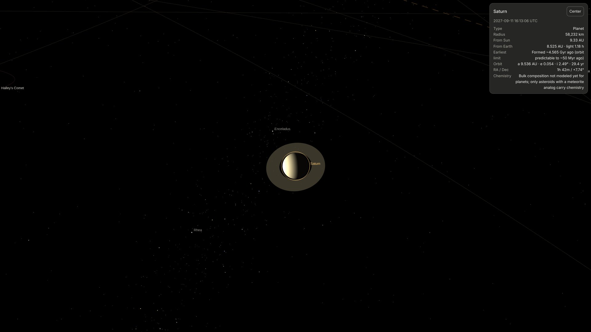

<div align="center">


# Human0

**Coming soon.**

</div>

## Apps

| App | |
|---|---|
| **[Maxey0 Context Plane](apps/maxey0-context-plane)** | A live map of where any task belongs and who should handle it: an MCP server for Claude and an interactive 3D graph. [Open the app](https://app.maxey0.com/app) · [Docs](https://app.maxey0.com/docs/) · [Research](https://app.maxey0.com/research/) |
| **[Space at Scale](plugins/space-at-scale)**<br> | A true-scale 3D simulation at three scales: the solar system in AU, the Local Bubble in light years and the Milky Way in thousands of light years, each running forward and backward in time to its physical limits. Runs inline in Claude (MCP App plus 25 tools) or as one offline HTML file (`plugins/space-at-scale/server/dist/space-at-scale.html`). |

## Install the plugin in Claude

```
/plugin marketplace add mmc7676/Human0
/plugin install maxey0-context-plane-graph@human0
/plugin install space-at-scale@human0
```
