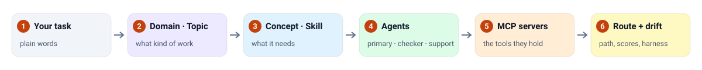
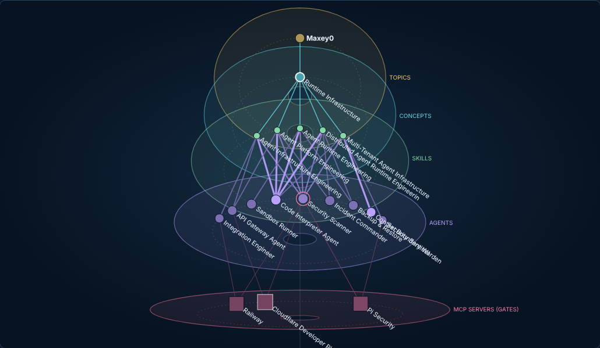
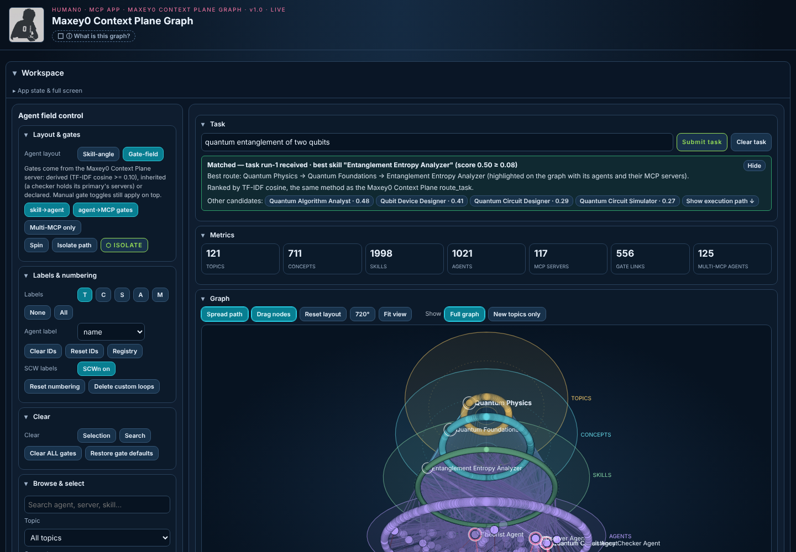
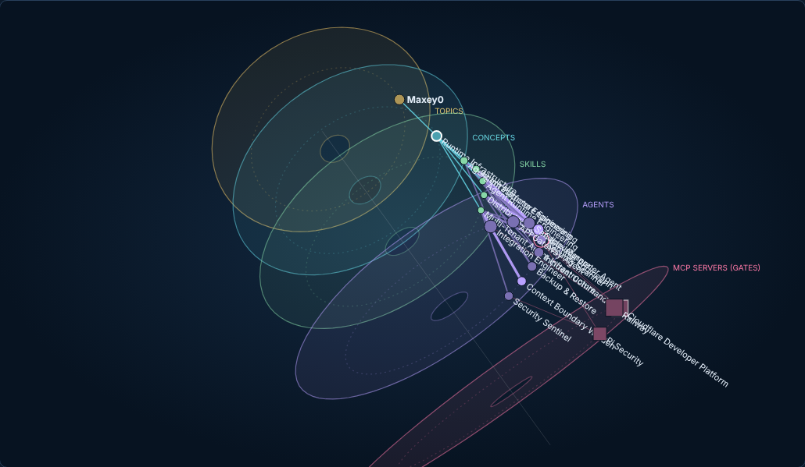
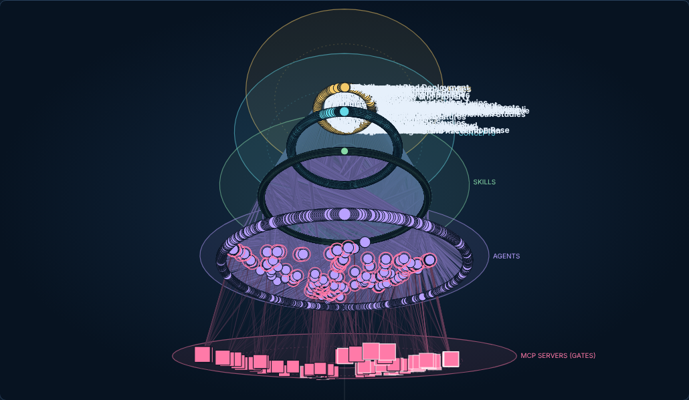

<div align="center">


# Maxey0

### The Context Plane: where any task belongs, and who should handle it

Give Maxey0 a task. It places it on one path (domain → topic → concept → skill → agents → MCP servers) and shows that path in a live 3D map, in your browser or inside Claude.

[](CHANGELOG.md)
[](docs/MCP_SERVER.md)
[](LICENSE)
[](https://app.maxey0.com/)

**[Open the app](https://app.maxey0.com/app)** · [Documentation](https://app.maxey0.com/docs/) · [Research](https://app.maxey0.com/research/) · [Getting started](#getting-started) · [Use it inside Claude](#use-it-inside-claude)

</div>

---

**Maxey0** is a context plane for agent systems. Before an agent acts on a task it has to answer *what kind of work is this?* and *who, with which tools, should do it?* Maxey0 answers both from one structured, versioned map of **11 domains, 128 topics, 711 concepts, 1,998 skills, 1,021 agents and 117 real MCP servers**, every node embedded in one shared space. It returns a candidate path, never an authorization: nothing runs until your orchestrator decides.

## Why Maxey0?

- **One path per task:** the topic, concept and skill a task falls under, plus the agents who should do it, check it and support it
- **Real tools:** the MCP servers agents hold are real, published servers; concepts, skills and agents are generated and structurally checked
- **Two signals:** TF-IDF plus dense bge-m3 embeddings in one inner-product space (exact-skill recovery 93.3% → 98.7% on the live server)
- **An observer lens with drift:** each level is read from the nodes chosen above it, and every route records how far each node moved to fit the task
- **Inside Claude:** a public MCP server and an MCP App that draws the graph in your conversation
- **Hand-off to Claude Code:** export a route as a project with one subagent per chosen agent

## How it works

<p align="center"></p>

<p align="center"></p>

## Getting started

| | How | Where |
|---|---|---|
| **Use it here** | Open the app, type a task, press Submit task | [app.maxey0.com/app](https://app.maxey0.com/app) |
| **Use it inside Claude** | Add a custom connector (below) | `https://app.maxey0.com/mcp` |
| **Install the plugin** | `/plugin marketplace add mmc7676/Human0` then `/plugin install maxey0-context-plane-graph@human0` | [`plugin/`](plugin/maxey0-context-plane-graph) |
| **Build with Claude Code** | Route a task in the app, then **Send to Claude Code** | the downloaded project folder |

### Use it inside Claude

1. In Claude: **Customize → Connectors → + Add → Add custom connector**
2. Name: `Maxey0 Context Plane`
3. URL: `https://app.maxey0.com/mcp`
4. Sign-in: none (the server is read-only)

Then ask Claude: *"Route this task with Maxey0: …"* or *"Open the Maxey0 graph."*

## Research

The papers behind Maxey0 (the Context Plane, Structured Context Worlds, System One and more) are at **[app.maxey0.com/research](https://app.maxey0.com/research/)**, each with a summary, a question-and-answer frame and a PDF.

## What's in the map

| | |
|---|---|
| **11 domains** | Agentic Systems and Software Engineering · Data Science and Quantitative Methods · Mathematical and Physical Sciences · Engineering · Life, Health and Mind Sciences · Earth, Environment and Place · Business, Finance and Economics · Society, Governance and Ethics · Languages, Literatures and Communication · Area and Identity Studies · Humanities and Arts |
| **128 topics** | formed from the concepts up, from Agent Harnesses and MCP Contracts to Derivatives, Quantum Physics and Translation Studies |
| **711 concepts · 1,998 skills** | 3–8 concepts per topic, 1–17 skills per concept |
| **1,021 agents** | every one a permanent **MaxeyN** key (Maxey0 is the orchestrator); each skill has a primary, a checker and support agents |
| **117 MCP servers · 556 links** | real, existence-checked servers, linked to the agents whose skills they fit |

Agents in the map are **context records**: a role, the skills it serves and the tools it would hold. They are not running agents.

## Use it

### In your browser

Open **[maxey0-context-plane-mcp.maxey0.workers.dev/app](https://maxey0-context-plane-mcp.maxey0.workers.dev/app)**. No sign-in, nothing to install. Type a task, press **Submit task**, and the graph lights up the route.

### In Claude, as a connector

1. **Customize → Connectors → Add custom connector**
2. URL: `https://maxey0-context-plane-mcp.maxey0.workers.dev/mcp` · Authentication: none
3. Ask:
   - *"Open the Maxey0 Context Plane graph for the task: price a call option."*
   - *"Use Maxey0 Context Plane to route: build a website for a real estate office."*
   - *"Which MaxeyN agent checks entanglement entropy results, and with which tools?"*

Where the host supports MCP Apps (Claude Desktop, for example), the graph opens inside the conversation.

### In Claude, as a plugin

Install [`plugin/maxey0-context-plane-graph`](plugin/maxey0-context-plane-graph). It adds the same connector plus two skills: one that teaches Claude to route with the map, and `topic-graph-generator`, which writes and validates a new topic when a task has no route.

### From any MCP client

```json
{
  "mcpServers": {
    "maxey0-context-plane": { "type": "http", "url": "https://maxey0-context-plane-mcp.maxey0.workers.dev/mcp" }
  }
}
```

## The graph app

<table>
<tr>
<td width="50%"><br><b>Route a task.</b> The best path is highlighted; the panel names it, the method, and the next candidates.</td>
<td width="50%"><br><b>Turn it any way.</b> Drag to rotate in any direction, Shift-drag to roll, 720° to tumble, Fit view to reset.</td>
</tr>
<tr>
<td><br><b>Isolate a path.</b> Each level is a ring; the path spreads around it and stays readable as the graph turns.</td>
<td><br><b>See the whole map.</b> 4,000 nodes on five stacked levels, with agent-to-server gates.</td>
</tr>
</table>

- **Route** any task with the same method the server uses; a task with no route offers to generate the missing topic.
- **Isolate** a topic, concept, skill, agent or server and its full path; **spread** it on the level rings; **drag** a node and everything below it follows on its own level.
- **Browse** by topic and concept, search any node, read its details, and tick which MCP gates place an agent.
- **Generate topics** with Claude, validate them, add them to the graph, keep or remove each one, and view new topics alone or with the full map.
- **Save state** (topics, layout, view) to the browser or a file; a state saved against another version of the map is refused rather than loaded wrong.
- **Inside Claude**, the app takes the task Claude passes in, can go full screen, and sends generation requests straight to the conversation.

The [user guide](docs/USER_GUIDE.md) walks through every control.

## The MCP server

Fifteen read-only tools, one prompt, nine resources and one resource template, over the MCP 2026-07-28 stateless protocol (and the earlier `initialize` handshake for older clients).

| Tool | Answers |
|---|---|
| `route_task` | Which topic, concept, skill, agents and servers fit this task? Flat ranking, or `mode: "lens"` to read each level from the nodes chosen above it |
| `search` | Which nodes match these words? |
| `nearest` | Which nodes, at any level, lie nearest this node or text in the shared embedding field? |
| `list_domains` · `list_topics` · `children` · `trace` | Browse the map and walk any node's parents |
| `get_topic` · `get_concept` · `get_skill` · `get_agent` · `get_mcp_server` | One node in detail |
| `get_harness` | One topic in full: every concept, skill, agent and server |
| `open_context_plane_graph` | Show the graph (MCP App), optionally routed to a task or opened on a topic |
| `validate_topic_pack` | Check a generated topic against the schema and the live map |

Prompt: `topic-graph-generator`. Endpoints: `/mcp` serves every domain; `/mcp/<domain id>` serves one domain. Full reference: [docs/MCP_SERVER.md](docs/MCP_SERVER.md).

Only what a call asks for is returned: about 7 KB of tool definitions up front, 3–10 KB per lookup, and one topic in full is about 49 KB. The full map stays on the server.

## How routing works

One method scores everything: search, routing, agent-to-server links and related concepts. Text is reduced to words (lower case, stop words removed, plurals folded), weighted by TF-IDF, and compared by cosine similarity. A match must share at least two words, so a single rare word is never enough.

| Use | Threshold |
|---|---|
| A task matches a skill | cosine ≥ 0.08 |
| An agent holds an MCP server | cosine ≥ 0.10, top 2 agents per server |
| Two concepts in different topics are related | cosine ≥ 0.40 |

**One embedding field for all six levels.** Every node (domain, topic, concept, skill, agent, MCP server) has a vector in the same TF-IDF space: domains and topics from their own text and their concepts, agents from the skills they serve, servers from their description and tools. A truncated SVD of all of them gives every node a location in one shared field, at one scale. In the graph, **Embedding field** places each node at that location on its level, so nodes that mean the same thing line up across levels; `nearest` answers the same question over MCP.

A **checker** agent holds every server its primary holds for the same skill, so it can verify by re-running the work, not just by reading it. More in [docs/ARCHITECTURE.md](docs/ARCHITECTURE.md).

## Limits

- **Generated content.** Concepts, skills and agents are generated and structurally checked, not expert-reviewed. MCP servers are real projects whose existence was checked; whether a server suits your use is yours to judge.
- **Lexical, not semantic.** Routing matches words. A task phrased in words the map doesn't use returns no route rather than a wrong one; rephrasing, or generating the missing topic, fixes it.
- **Context, not execution.** A route is a candidate, never an authorization. Some listed servers can place orders or move money; this project never calls them.

## Privacy

The server is read-only and has no accounts. It stores nothing you send it, and the app keeps its saved state in your own browser. See [PRIVACY.md](PRIVACY.md).

## Repository

```
server/   MCP server (TypeScript, Cloudflare Workers) and its tests
app/      the graph app: build script, built page, browser tests
SCW1/     the map: source topic packs, the ontology spec, the built graph and one harness per topic
tools/    the map builder and topic-pack generator (Python)
plugin/   the Claude plugin
docs/     user guide, server reference, architecture, development
```

Build, test and deploy: [docs/DEVELOPMENT.md](docs/DEVELOPMENT.md). Changes: [CHANGELOG.md](CHANGELOG.md).

## Support

Questions and bug reports: [GitHub Issues](https://github.com/mmc7676/Human0/issues).

## License and credit

[Apache License 2.0](LICENSE). Redistributions keep the [NOTICE](NOTICE) file.

Structured Context Windows (SCW), Maxey0 and Human0 were created by **Human0 (Mike Cohan)**; SCWs were [first published on 27 September 2025](https://claude.ai/share/551bdb74-8a71-4b95-a8a7-260241fd760b). To cite this project, use **Cite this repository** on the [Human0 repository page](https://github.com/mmc7676/Human0).

<sub>Built with Claude.</sub>
