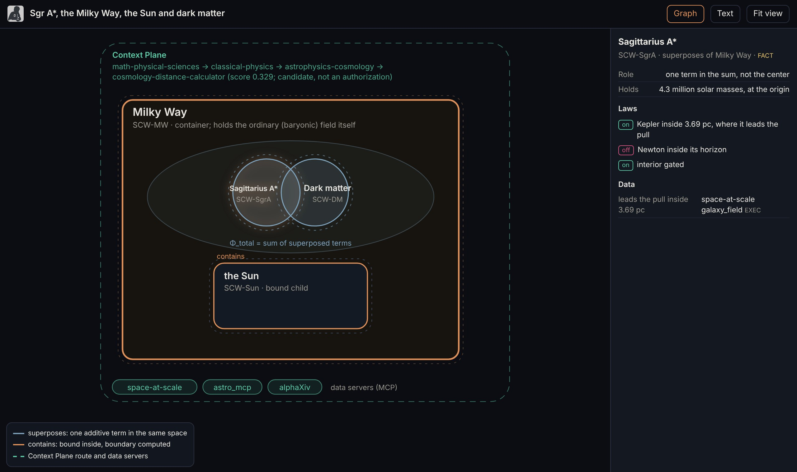

<div align="center">


# SCW Modeler

**Model any system as Structured Context Windows, then read it as text or see it as a graph.**

A Human0 app · Claude plugin with a skill, an MCP server and an inline MCP App



</div>

## What it does

Ask `/scw-modeler text, Sag A, The Milky way, the sun, and dark matter` and you get:

```
SCW-MW    Milky Way       container; holds the ordinary (baryonic) field itself
 ├─ superposes ──── SCW-SgrA  Sagittarius A*  (field component, horizon)
 ├─ superposes ──── SCW-DM    Dark matter     (field component, inferred)
 └─ contains ────── SCW-Sun   the Sun         (bound child)
```

The text continues with what each SCW holds, its laws (on, off or inherited), how the parts interact, tables, every number with its source and evidence label, the Context Plane route, and a one-line answer.

Ask with `viz` instead and the same model opens inline as the graph above:

- each SCW sits inside its own SCW boundary;
- superposed terms overlap in one shared field;
- contained children nest inside their parent;
- other relations become typed edges;
- the Context Plane route and its data servers form the outer ring.

Click any SCW to see its role, holdings, laws and data.

## How it works

1. **Model:** the skill builds only the parts you named, with one root and one typed relation per child: contains, superposes, passes-through, signals, shares-gravity, feeds or governs.
2. **Route and find data:**
   - The [Maxey0 Context Plane](../../apps/maxey0-context-plane) routes the system to a domain, topic, skill and agents, and lists their gated MCP servers.
   - `/find-mcp` and the connector registry add the data servers to use.
   - Numbers come from tools (for example Space at Scale's `galaxy_field`) and carry EXEC, FACT, DERIVED or HYPOTHESIS labels.
3. **Validate and return:** `validate_scw_model` enforces one root, known parents, known relations, unique ids, no cycles, valid law states, and a source for every data row. `scw_model_text` or `render_scw_model` returns the result.

## Install

```
/plugin marketplace add mmc7676/Human0
/plugin install scw-modeler@human0
```

Requires Node 18 or later. The server is one bundled file (`server/server.bundle.js`). The plugin also connects the hosted Maxey0 Context Plane endpoint. Space at Scale, if installed, supplies astronomy numbers.

## Tools

| Tool | Does |
|---|---|
| `scw_relations` | lists the relation types, evidence labels and law states |
| `validate_scw_model` | checks a model and lists every error |
| `scw_model_text` | renders the text answer |
| `render_scw_model` | opens the inline graph (MCP App) |
| `scw_model_html` | returns a standalone HTML graph with the model embedded |

## Tests

```
cd server && npm ci && node build.js && node test.js
```

The last run passed 26 of 26 checks: the model rules, the reference text layout, all five tools over stdio, the App resource, and the Human0 logo embedded byte for byte. A headless Chrome check of the graph found 4 SCWs drawn, the click-to-inspect panel working, the text toggle working and no console errors.

## Privacy

The SCW Modeler server stores nothing and makes no network requests. The Context Plane endpoint receives only the short routing phrase. `examples/milky-way.json` is the model behind the screenshot.

<sub>SCW Modeler by Human0 · MIT</sub>
