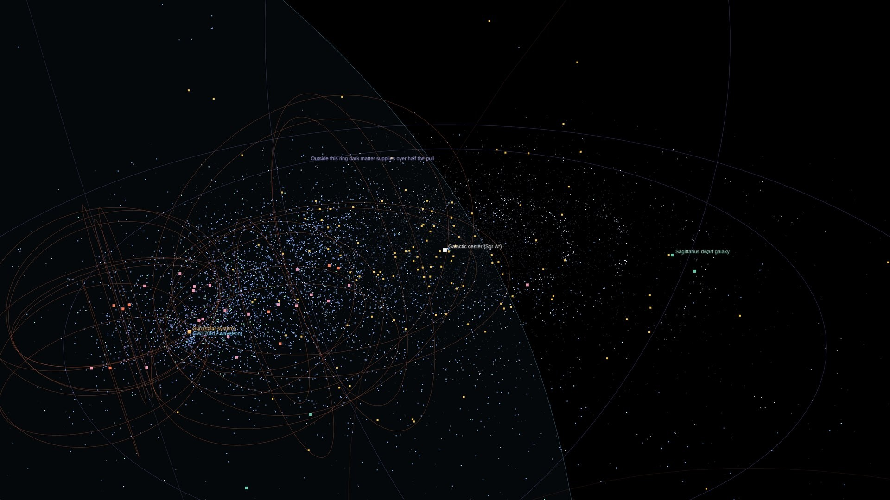

# Space-at-Scale

**The solar system, the Local Bubble and the Milky Way at true scale, in one 3D view that runs forward and backward in time.**

A Human0 app · runs inline in Claude as an MCP App

## What this plugin is

This is the directory edition of Space-at-Scale. It contains no code: it connects Claude to the hosted Space-at-Scale MCP server at `https://space-at-scale-mcp.maxey0.workers.dev/mcp` and adds the `space-at-scale` skill. It works on claude.ai, Claude Desktop and Claude Code.

Type `/space-at-scale`, or ask "show me the Milky Way", "plan a trip to Mars" or "find $3,000,000 of platinum within 5 AU".

## Three scales, one view

| Scale | |
|---|---|
| **Solar system** | **In AU.** 132 bodies and spacecraft on real orbits, rewindable 4.567 billion years. |
| **Local Bubble** | **In light years.** 3,665 naked-eye stars within 1,000 ly on measured space velocities, 30 million years each way. |
| **Milky Way** | **In thousands of light years.** Sgr A* and 44 S-stars, the dark matter halo, 161 globular clusters, 50 satellite galaxies, 3,563 pulsars and 391 gravitational-wave events, back to the Big Bang. |

## Tools

The hosted server offers 22 tools on its current plan. Three heavier tools (`run_evals`, `generate_universe`, `find_mining_targets_parallel`) need more computing time per call than the current hosting plan allows and are not offered yet. The full local edition with every tool is in [`plugins/space-at-scale`](../space-at-scale).

## Privacy

Nothing is stored and no sign-in is needed. See [PRIVACY.md](PRIVACY.md).

## Source and licenses

Server source: [`plugins/space-at-scale/server`](../space-at-scale/server) (the same code, served by [`apps/space-at-scale-mcp`](../../apps/space-at-scale-mcp)). Code is MIT; data licenses are in [DATA-LICENSES.md](DATA-LICENSES.md).
