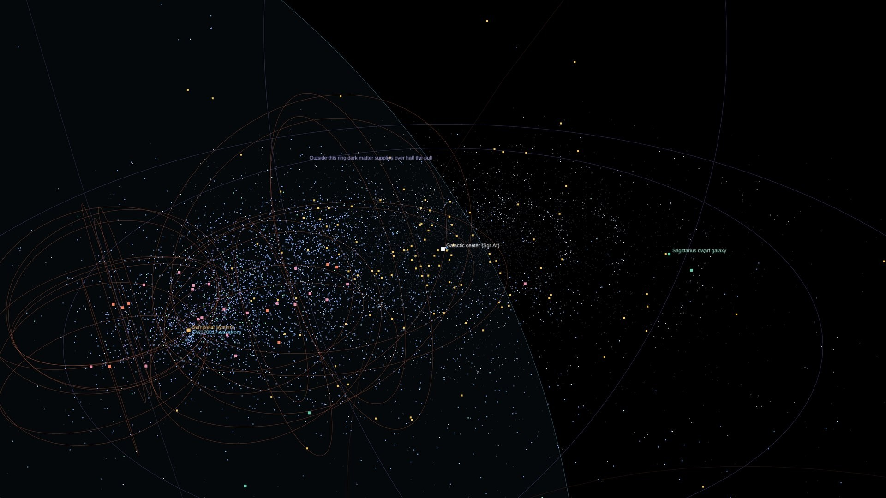

<div align="center">


# Space at Scale

**The solar system, the Local Bubble and the Milky Way at true scale, in one 3D view that runs forward and backward in time.**

A Human0 app · runs inline in Claude as an MCP App, or offline as one HTML file



</div>

## Three scales, one view

| Scale | |
|---|---|
| **Solar system** | **In AU.** 132 bodies and human-made objects on real orbits: the 8 planets, their major moons, the largest asteroids, KBOs, Halley's Comet and 72 spacecraft. Spacecraft follow their routes, appear on their launch dates and disappear before them. Rewind it 4.567 billion years, to the formation of the solar system. |
| **Local Bubble** | **In light years.** Every naked-eye star (V ≤ 5.8) within 1,000 ly, 3,665 stars in all, moving on its measured space velocity, inside the Zucker et al. 2022 bubble model. Its expansion origin and stellar barycenter are marked. The five escape craft head outward on their real directions. Runs 30 million years each way. |
| **Milky Way** | **In thousands of light years.** Sgr A* and 44 S-star orbits, the dark matter halo, 161 globular clusters and 50 satellite galaxies on measured orbits, 3,563 pulsars, supernova light shells, gravitational-wave fronts and 391 GWOSC events. Turn dark matter off and watch the satellites escape. Runs back to the Big Bang. |

Click any dot for live specs, then **Center** to follow it. Zoom past the Oort Cloud and the view hands off to the Local Bubble. Zoom past 15,000 ly and it hands off to the galaxy.

## What makes it different

- **Every number is computed, not looked up.** One physics core drives both the view and the server, byte for byte. The physics evals pass in the app and in the server: 77 of 77 for our universe, 96 of 96 with all three universes loaded.
- **Time has limits, and the app tells you where they are.** Planets don't exist before they formed, spacecraft don't exist before launch, and each scale stops at the point where its model stops being valid.
- **The galaxy is a typed graph, not a tree.** Below the view is a Structured Context Window (SCW) graph. Sgr A* and the dark matter halo *superpose* with the disk, and none of them is "the center". The Sun is *contained* inside its 1.37 pc Jacobi radius. Supernovae and gravitational waves *signal* at the speed of light.
- **A dark-matter hypothesis lab.** Model dark matter as the gravity of a hidden universe that shares gravity but not light, and test it against seven observations, side by side with the standard halo.
- **Fully reversible.** Everything you add can be removed, from comets and generated universes to toggles and time. **Reset everything** restores the starting state.

## Install in Claude

```
/plugin marketplace add mmc7676/Human0
/plugin install space-at-scale@human0
```

Then ask: *"open Space at Scale"*, *"plan a trip to Mars"* or *"which asteroids have the most platinum within 5 AU?"*.

Requires Node 18 or later. The server ships as one bundled file (`server/server.bundle.js`), so there is nothing else to install.

**Offline:** open `server/dist/space-at-scale.html` in any modern browser. It has no network requests and no install.

## 25 tools

| Group | Tools |
|---|---|
| View | `open_space_at_scale` |
| Simulation | `sim_state`, `sim_clock`, `events`, `run_evals` |
| SCW graph | `scw_get`, `scw_children`, `scw_search`, `scw_laws`, `scw_inheritance_rules`, `scw_relations`, `validate_app_dropin` |
| Galaxy | `galaxy_field`, `galaxy_object`, `energy_ledger`, `link_hidden_universe` |
| Missions and mining | `plan_trip`, `plan_mission`, `find_mining_targets`, `find_mining_targets_parallel`, `run_extraction_campaign` |
| What-ifs | `inject_interstellar_comet`, `generate_universe`, `generate_exotic_universe`, `remove_state` |

Public mode (`SCW_PUBLIC=1`, the default in this plugin) stores nothing. Generated universes and comets are returned, not persisted.

## Tests and provenance

```
cd server && npm ci && node test.js && node test-http.js
```

The last run passed 87 of 87 checks over stdio and 9 of 9 over HTTP (`TEST-REPORT.md`). `PROVENANCE.json` records the SHA-256 and byte length of every shipped file and raw catalog. `node release.js` rebuilds, bundles, tests, packages and verifies the plugin. `server/tools/build-galaxy.js` rebuilds `galaxy.json` deterministically from the raw catalogs.

## Data

HYG Database v4.1, the ATNF Pulsar Catalogue (via Stellarium), galpy, gala `MilkyWayPotential` v1, GWOSC and published S-star orbits. Licenses are mixed (MIT, CC BY-SA 4.0, BSD-3-Clause and GPL-2.0-or-later); see `DATA-LICENSES.md`. Architecture, the requirement coverage matrix and known limitations are in `INTEGRATION.md`.

## Remote (optional)

`server/http.js` and `Dockerfile` serve Streamable HTTP with a bearer token. Deploy with `SCW_PUBLIC=1`.

## Privacy

Space at Scale collects and stores no user data. Public mode persists nothing, and the inline app makes no network requests.

---

<sub>Space at Scale by Human0 · github.com/mmc7676/Human0 · MIT for code; data licenses in DATA-LICENSES.md</sub>
